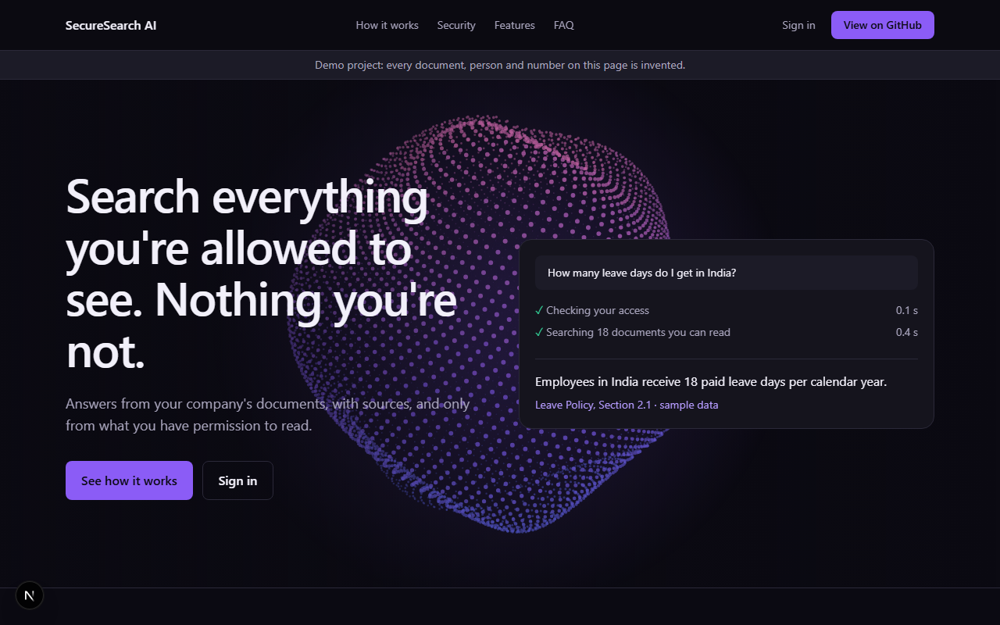
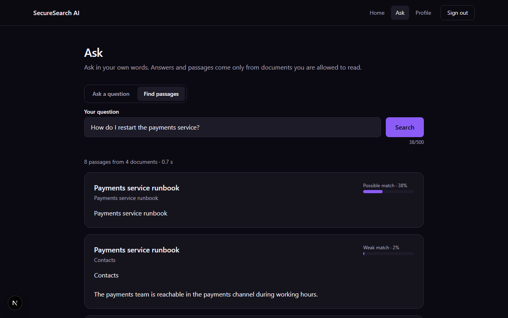
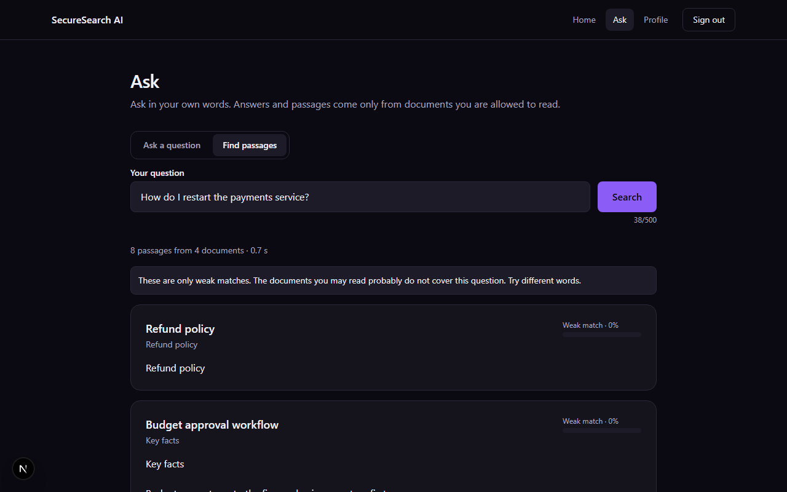
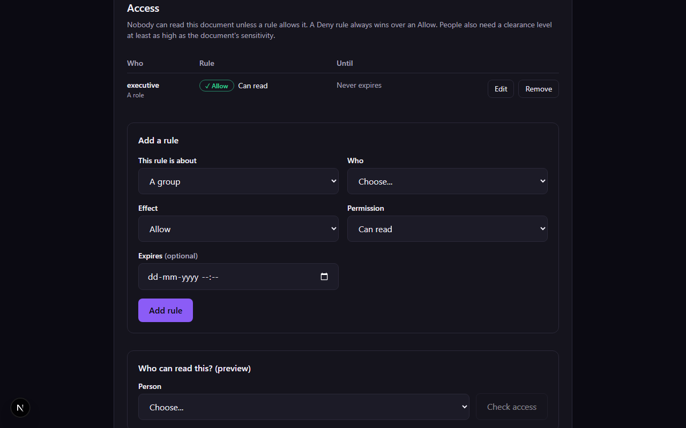
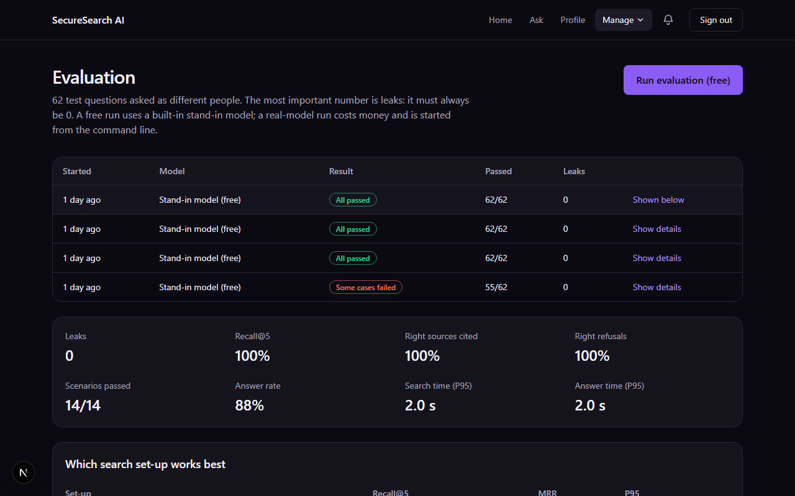
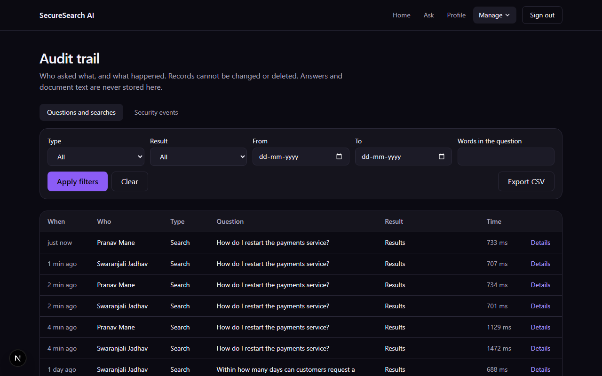
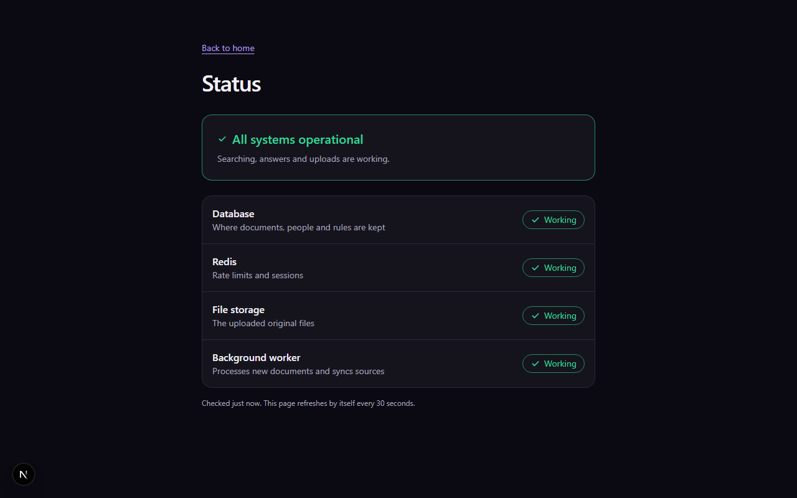
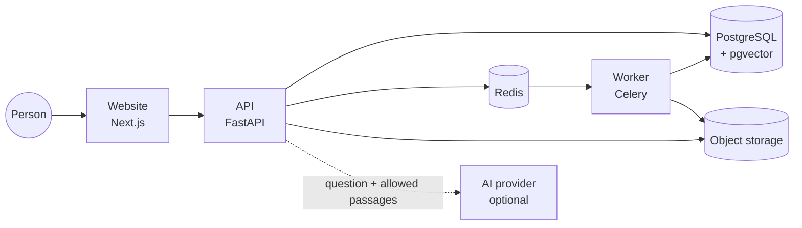

# SecureSearch AI

*Ask your company's documents a question and get a short answer with sources, and only from the documents you are allowed to read.*

[](https://github.com/aiwithpranav/securesearch-ai/actions/workflows/ci.yml)
[](LICENSE)



> **Demo project.** Every document, person and number in this repository is invented. Read [what it does not do](docs/security.md) before putting real documents in.

## The problem
A search or chat tool over company documents is only useful if it never shows a person something they may not read. Most RAG demos search everything first and hope to filter later, so a payroll file can leak into an answer, a log line or a prompt.

## The idea
The permission check happens **inside the database query, before anything is scored**, and is checked again before the answer is written and once more on every cited source. Deny wins, access is deny-by-default, the system administrator is not automatically a reader, and nothing is cached. A leak test with secret marker words runs on every pull request and fails the build if one marker reaches a person who may not read it.

The same question, asked by two different people (an engineer and a finance manager):

| Engineer (may read the runbook) | Finance manager (may not) |
|---|---|
|  |  |

## What it does
* **Search and answers:** hybrid retrieval (PostgreSQL full-text + pgvector, merged with RRF, reordered by a local cross-encoder), short answers with citations that are checked against the passages that were sent, one uniform refusal when the evidence is weak.
* **Access rules:** allow or deny a person, role, group, department or everyone, with optional expiry; a plain-English "who can read this and why" preview; history of every change.
* **Documents:** upload PDF, DOCX, TXT or MD; background indexing that never damages the previous good version; versions and restore.
* **Sources:** a GitHub folder is imported and kept up to date by an incremental sync; access follows the repository's team file and collaborators.
* **Audit:** every search and answer is recorded (ids and outcome, never the answer) in an append-only table the database itself protects; security staff read and export it; the system administrator cannot.
* **Operations:** public status page, retention, backup and restore scripts (restore tested on an empty machine), dashboards, knowledge gaps (unanswered questions without names), an evaluation dashboard.

| Access rules of a document | Evaluation dashboard |
|---|---|
|  |  |
| **Audit trail** | **Status page** |
|  |  |

More screens: [documents](docs/images/04-admin-documents.png), [overview](docs/images/06-overview.png), [knowledge gaps](docs/images/10-knowledge-gaps.png).

## Architecture
A modular monolith: FastAPI (plus a worker from the same image), Next.js, PostgreSQL with pgvector, Redis, S3-compatible storage. Local embedding and reranker models; the only optional outside call is to an AI provider to write the answer.



Details, with the full question flow and the sync flow: [docs/architecture.md](docs/architecture.md).

## Security model
Six walls, each backed by tests: (1) identity and role read from the database on every request, (2) permission filter inside the keyword query, (3) the same inside the vector query, (4) a recheck before the answer is written, (5) citation and output validation, (6) a leak gate in the build. Plus Argon2id passwords, rotating refresh cookies with theft detection, lockout, rate limits, upload checks, append-only audit, a secret scan of the whole history and dependency scans.

Every threat is tied to the test that proves it, and the gaps are listed (no SSO, no MFA, no independent audit): [docs/security.md](docs/security.md). To report a problem: [SECURITY.md](SECURITY.md).

## Evaluation
Measured on 62 questions asked as 8 different people over 48 synthetic documents, run on commit `c1a778c` with the real local models and a stand-in answer writer (so it measures search, permissions, refusals and logging, not the wording of a live model):

| Measure | Result | Target |
|---|---|---|
| Unauthorized leakage | **0 of 62** | 0 |
| Recall@5 (hybrid + reranker) | 1.00 | 0.85 |
| Citation correctness | 1.00 | 0.90 |
| Refusal accuracy | 1.00 | 0.90 |
| Scenarios (rule revoked, group left, deleted, expired, ...) | 14 of 14 | all |
| P95 search latency (laptop CPU) | 2.0 s | under 5 s |

Honest limit: the set is small and synthetic, and 4 of 8 paraphrase questions are not answered. Method, tuning and limits: [docs/evaluation-report.md](docs/evaluation-report.md).

## Quick start
You need Docker (running), Git, Node.js 20.9 or newer (24 tested), about 15 GB of free disk and an internet connection for the first build (it downloads PyTorch and two models; run again if a download fails).

Check the computer first (it only looks, it changes nothing):
```bash
bash scripts/check_prereqs.sh            # Linux, macOS, Git Bash
```
```powershell
powershell -ExecutionPolicy Bypass -File scripts/check_prereqs.ps1   # Windows
```

Then, from the repository root:
```bash
bash scripts/setup_env.sh                 # Windows: scripts/setup_env.ps1. Creates .env with random secrets
docker compose up -d --build              # first build takes several minutes
docker compose exec backend alembic upgrade head
docker compose exec backend python -m app.scripts.seed_users
docker compose exec backend python -m app.scripts.load_synthetic_docs
docker compose exec backend python -m app.scripts.seed_access
cd frontend && npm ci && npm run dev      # website on http://localhost:3000
```
Open <http://localhost:3000/login>. The demo people (all invented) are `swara@demo` (engineer), `pranav@demo` (finance), `dhanashree@demo`, `akshay@demo`, `sanjana@demo` (security administrator), `shivam@demo`, `prashant@demo` (administrator) and `karunesh@demo`; their password is `SEED_USER_PASSWORD` in your local `.env`. Demo passwords are easy to guess on purpose: use them on a developer machine only.

Try it: sign in as `swara@demo`, open **Search**, choose "Find passages" and ask *How do I restart the payments service?*; then sign in as `pranav@demo` and ask the same. The first person gets the runbook passages; the second gets only unrelated passages (for example the leave policy) and cannot tell that the runbook exists.

Optional:
* More data for the evaluation: `docker compose exec backend python -m app.scripts.load_eval_corpus`, then **Evaluation** in the Manage menu (or `python -m app.scripts.run_eval`).
* Written answers: put `OPENAI_API_KEY` in your local `.env` (never commit it) and restart the backend.
* A GitHub source: the folder `demo-docs/` is a ready example; see [ADR 035](docs/adr/035-github-connector.md).
* Test mailbox (reset and invitation emails): <http://localhost:8025>. API reference (interactive): <http://localhost:8000/api/docs>.

Stop with `docker compose down` (data kept); `docker compose down -v` also deletes the database. Running it for real on a server: [deployment guide](docs/deployment.md). Backup and restore: [runbook](docs/runbook.md).

## Tech stack
* **Frontend:** Next.js 16.4.2, React 19.3.0, Tailwind CSS 4.3.3, TypeScript 5.9
* **Backend:** Python 3.12, FastAPI 0.143.0, SQLAlchemy 2.1.4, Alembic 1.20.0, Pydantic 2.14.0, Celery 5.6.3
* **Data:** PostgreSQL 17 with pgvector 0.8.0, Redis 7.4.2, SeaweedFS 4.48 (S3 API)
* **Models (local, CPU):** BAAI/bge-small-en-v1.5 (embeddings), BAAI/bge-reranker-base (reranker), PyTorch 2.14.1, sentence-transformers 6.1.0
* **Quality:** pytest, mypy, ruff, ESLint, Vitest, Lighthouse CI, gitleaks, pip-audit, GitHub Actions

All pins and the reasons: [docs/adr/](docs/adr/).

## Project structure
```text
backend/        FastAPI app, worker tasks, migrations, scripts, tests
frontend/       Next.js website (landing, sign-in, search, admin screens, status)
demo-docs/      Invented documents for the GitHub-source demo
sample-data/    Invented documents for local loading
scripts/        Environment setup, readiness check, backup and restore
docs/           Architecture, security model, API reference, runbook, ADRs, phases
```

## Testing
```bash
docker compose exec backend pytest -q     # 700+ tests, own database
cd frontend && npm test                   # 130+ unit tests
```
Every pull request also runs style, types, the leak gate, a coverage gate on the security code (94% now), migration checks, secret and dependency scans, Lighthouse and the image build: [docs/ci.md](docs/ci.md).

## Roadmap and known limitations
Built in nine phases (tags `v0.1` to `v1.0`) plus a scale demo (Phase 10, [results record](docs/phases/phase-10-scale-demo/RESULTS.md)); what is tested, the expected limits and the roadmap: [docs/scale-and-limits.md](docs/scale-and-limits.md); errors, retries and fallbacks: [docs/error-handling.md](docs/error-handling.md). The ideas left over are in [docs/BACKLOG.md](docs/BACKLOG.md), the problems met on the way in [docs/CHALLENGES.md](docs/CHALLENGES.md), the history in [CHANGELOG.md](CHANGELOG.md).

Not done, on purpose or yet:
* Email and password sign-in only: no single sign-on, no automatic user provisioning, no two-factor.
* One connector (GitHub). Others (Drive, SharePoint, Confluence) are next.
* Single machine deployment; no high availability.
* English documents only; the paraphrase recall of the small embedding model is limited (see the evaluation).
* Legal pages are drafts, not legal advice. No independent security audit.

## Contributing, licence, security
Issues and pull requests are welcome; every change runs the full checks. Licence: [MIT](LICENSE). Security reports: [SECURITY.md](SECURITY.md).
