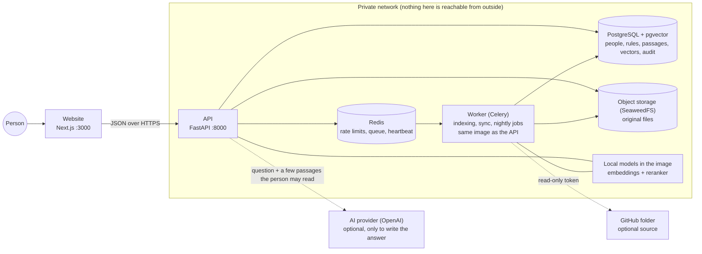
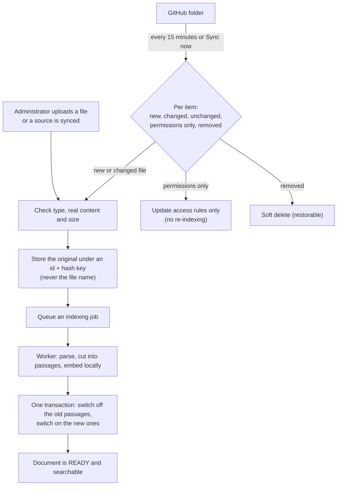

# Architecture

SecureSearch AI is a **modular monolith**: one FastAPI application (plus a background worker made from the same image) and a Next.js website, on top of PostgreSQL with pgvector. There are no microservices to keep in step; the parts are separated by folders and tested contracts, not by network calls.

## The system



* **Website:** landing, sign-in, search and answers, and the administration screens (documents, access rules, users, groups, sources, audit, overview, evaluation, knowledge gaps) plus a public status page.
* **API:** sign-in and sessions, documents and ingestion, access rules, retrieval, answers, audit, dashboards, sync. Every route checks who is calling; the full list is [docs/api.md](api.md).
* **Worker:** indexes uploaded documents, runs source syncs, a heartbeat for the status page, and nightly housekeeping (audit retention, old passages). It is the only service that talks to GitHub, and it holds the GitHub token; the API holds the OpenAI key.
* **Only the API and the website are reachable from the host.** The database, Redis and the file store are on an internal network.

## How a question is answered

The permission check is **inside the database query**, before anything is scored. The six walls are numbered as in [docs/security.md](security.md).

```mermaid
sequenceDiagram
    autonumber
    actor P as Person
    participant A as API
    participant D as PostgreSQL
    participant L as AI provider
    P->>A: question (signed in)
    A->>A: wall 1: who is this, which role (read from the database)
    A->>D: wall 2 and 3: keyword search and vector search, both restricted to the documents this person may read
    D-->>A: candidate passages (only allowed ones)
    A->>A: fuse the two lists (RRF), rerank with the local cross-encoder
    A->>D: wall 4: look again, every passage must still be readable
    A->>A: confidence check (too weak means one uniform refusal)
    A->>L: question + the few passages, marked as untrusted data
    L-->>A: JSON: answer + sources
    A->>A: wall 5: every cited source must be one of the passages sent; no links, HTML or code
    A->>D: audit row (ids and outcome, never the answer) in the same transaction
    A-->>P: short answer with sources, or one uniform refusal
```

If the audit row cannot be written, the person gets nothing ("no audit, no answer"). Wall 6 is the build: a leak test with secret marker words fails the pull request ([docs/ci.md](ci.md)).

## How documents get in and stay current



* A failed indexing job never damages the previous good index.
* Unchanged files are skipped; a permission-only change does not re-embed anything; a person removed from a team at the source loses access at the next question.
* A broken or empty source cannot wipe the index (safety stops). Details: [ADR 034](adr/034-sync-engine.md), [ADR 035](adr/035-github-connector.md).

## How sign-in works
1. `POST /auth/login` checks the password (Argon2id) and returns a 15-minute access token (kept only in browser memory) and an httpOnly refresh cookie.
2. The access token holds only the person's id. **Roles, groups, clearance and country are read from the database on every request.**
3. After a reload the website calls `/auth/refresh`; the server rotates the cookie, and reuse of an old cookie ends the whole session.

Details: [ADR 023](adr/023-auth-implementation-details.md).

## Operations
Retention, the status page, backup and restore: [ADR 037](adr/037-operations.md) and the [runbook](runbook.md). Production start: [deployment guide](deployment.md).

## Decisions
Every significant choice has a short record in [docs/adr/](adr/); difficulties met on the way are in [CHALLENGES.md](CHALLENGES.md); open ideas are in [BACKLOG.md](BACKLOG.md).
